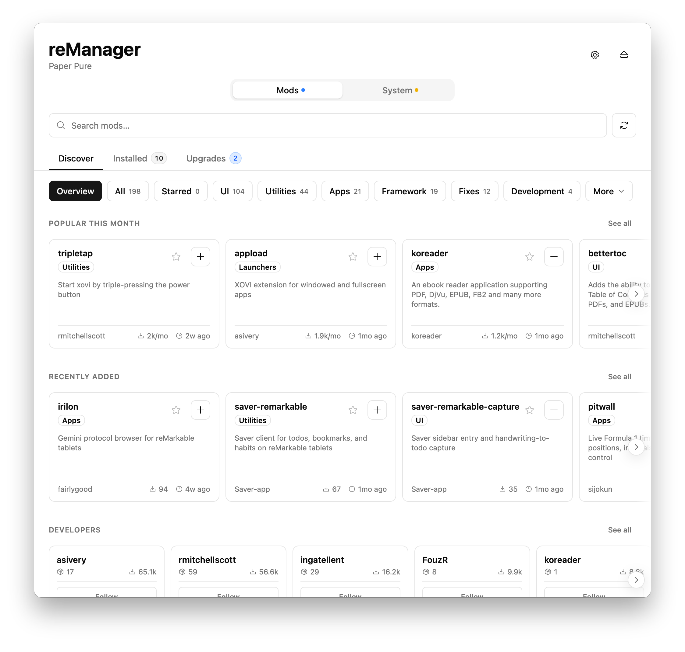
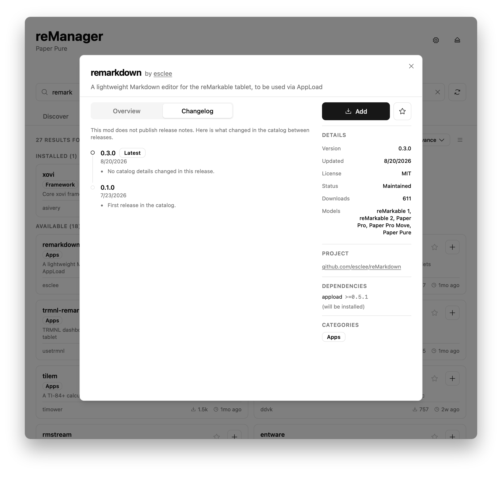
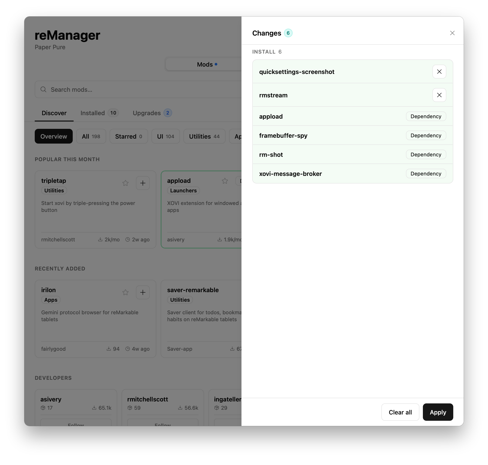
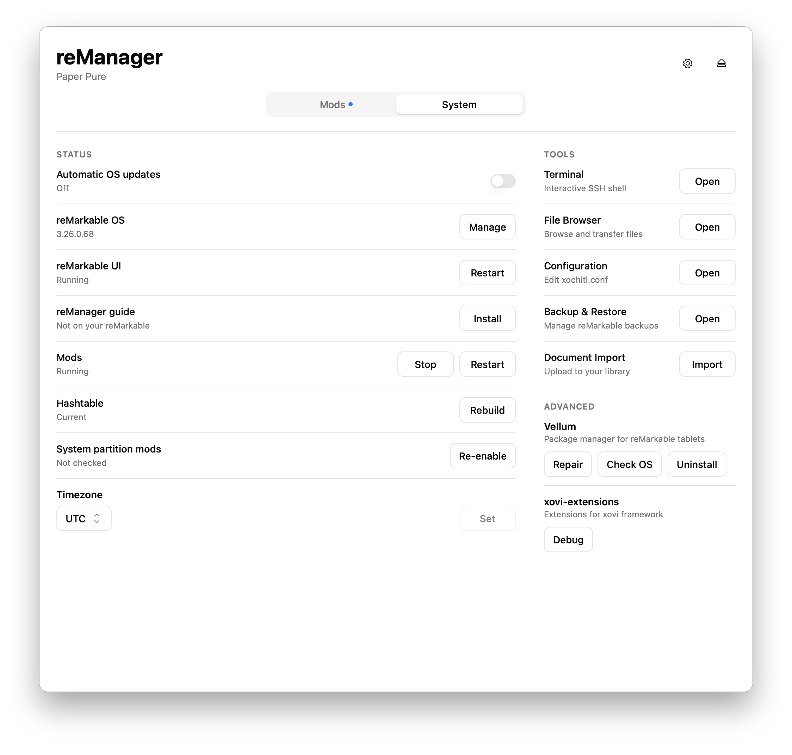

# reManager

<p align="justify">

[](https://remarkable.com/store/remarkable)
[](https://remarkable.com/store/remarkable-2)
[](https://remarkable.com/store/overview/remarkable-paper-pro)
[](https://remarkable.com/products/remarkable-paper/pro-move)
[](https://remarkable.com/products/remarkable-paper/pure)

A desktop and mobile app for managing mods on reMarkable tablets.

Powered by the [Vellum](https://github.com/vellum-dev) package manager. See the [mod catalog](https://vellum.delivery) for a full list of supported mods.

Video walkthrough of setup and features: https://www.youtube.com/watch?v=AiLoDKfpeag

## Features

- Multi-Device Management: Save multiple reMarkables with password, key, or SSH agent authentication
- Mod Management: Browse, install, upgrade, and uninstall mods with automatic dependency resolution
- System Management
  - Status checks with one-click fixes
  - Guided recovery after OS updates
  - Enable / disable reMarkable auto-updates
  - Set system timezone
  - Start, stop, and restart mods and launchers
  - Run mod-provided commands
  - Set PNGs as sleep screen
- Tools
  - Interactive terminal: Access a complete shell session on your reMarkable without leaving reManager
  - File browser: Browse reMarkable's filesystem, transfer files to and from your reMarkable
  - Backup & Restore: Backup and restore reMarkable document library and configuration
  - Configuration editor: Edit system configuration files with a WYSIWYG editor with syntax highlighting
  - Document import: Import PDFs, EPUBs, and rmdocs directly into the reMarkable document library
  - OS manager: View, install, and switch between reMarkable OS versions
 
## Where To Get Help

- **Mod packaging issues** should be submitted to the [Vellum package repository](https://github.com/vellum-dev/vellum).
- **Issues with the software being packaged** should be submitted to the relevant upstream projects, which are linked in the mod catalog and in each mod's details in reManager.
- **Issues with reManager itself** should be opened in this repository.
- **For general questions or help**, join the [community Discord](https://discord.gg/u3P9sDW) where many helpful and knowledgeable people, including mod developers, are active.

## Installation

### Linux
#### Flathub
```shell
flatpak install flathub io.scottlabs.reManager
```

#### Manual
Download and run the [latest release](https://github.com/rmitchellscott/reManager/releases/latest):
- Flatpak
- Binaries
   - Requires GTK 4 and WebKitGTK 6.0
   - Saving passwords requires GNOME keychain and the `login` collection available. [More info here](https://github.com/zalando/go-keyring?tab=readme-ov-file#linux-and-bsd).
 
Built for x86_64 (amd64) and aarch64 (arm64)

### macOS
#### App Store
Install from the [Mac App Store](https://apps.apple.com/app/id6812167832).

#### Homebrew
```shell
brew install --cask remanager
```

#### Manual
Download and run the [latest release](https://github.com/rmitchellscott/reManager/releases/latest).  
Universal binary supports both Intel and Apple Silicon. 

### Windows
#### Microsoft Store
Install from the [Microsoft Store](https://apps.microsoft.com/detail/9NV10641JZDS).

#### Manual
Download and run the [latest release](https://github.com/rmitchellscott/reManager/releases/latest).  
Built for x86_64 (amd64) and arm64.  
Bypassing SmartScreen is likely required.

### iPhone and iPad

Install from the [App Store](https://apps.apple.com/app/id6812167832).

### Android

Install from [Google Play](https://play.google.com/store/apps/details?id=io.scottlabs.reManager), or download the APK from [GitHub Releases](https://github.com/rmitchellscott/reManager/releases).

## Screenshots

  <picture>
    <source
      srcset="assets/readme/screenshot-discover-dark.png"
      media="(prefers-color-scheme: dark)"
    >
    
  </picture>

  <picture>
    <source
      srcset="assets/readme/screenshot-package-dark.png"
      media="(prefers-color-scheme: dark)"
    >
    
  </picture>

  <picture>
    <source
      srcset="assets/readme/screenshot-plan-dark.png"
      media="(prefers-color-scheme: dark)"
    >
    
  </picture>

  <picture>
    <source
      srcset="assets/readme/screenshot-system-dark.png"
      media="(prefers-color-scheme: dark)"
    >
    
  </picture>

## Tech Stack

Built with [Wails](https://wails.io/) (Go + React/TypeScript).

## License
Copyright (C) 2026 Mitchell Scott

Licensed under the GNU General Public License v3.0.
