## Navigating This Guide

To open the table of contents on your reMarkable:

1. Press the page overview button in the toolbar:

2. Press the table of contents button in the page overview:

\

To change the font size or margins, open the **More Tools** menu (three dots) in the toolbar. Then select **Text Settings**. On the Paper Pro Move, go to **Adjust View**, then **Text Settings**.

# Introduction

reManager manages mods on your reMarkable from your computer, phone, or tablet. You can browse, install, upgrade, and remove mods without the command line.

\

reManager runs on macOS, Windows, Linux, iPhone, iPad, and Android. It works with every reMarkable device:

- reMarkable 1
- reMarkable 2
- reMarkable Paper Pro
- reMarkable Paper Pro Move
- reMarkable Paper Pure

\

## What is Vellum?

reManager uses a package manager called Vellum to install mods. When you first connect, reManager offers to set up Vellum on your reMarkable.

# Connecting to Your reMarkable

## Finding Your Connection Details

On your reMarkable, go to **Settings › General › Help › Copyrights and licenses**. This screen shows the IP address and password for SSH. Over USB, the IP address is `10.11.99.1`.

On the Paper Pro, Paper Pro Move, and Paper Pure, turn on developer mode first. The QR code below links to reMarkable's instructions.

USB and Wi-Fi both work on every platform. Your computer, phone, or tablet can ask for Local Network permission the first time reManager connects. Some Android devices ask you to allow each USB connection.

\

## Connecting for the First Time

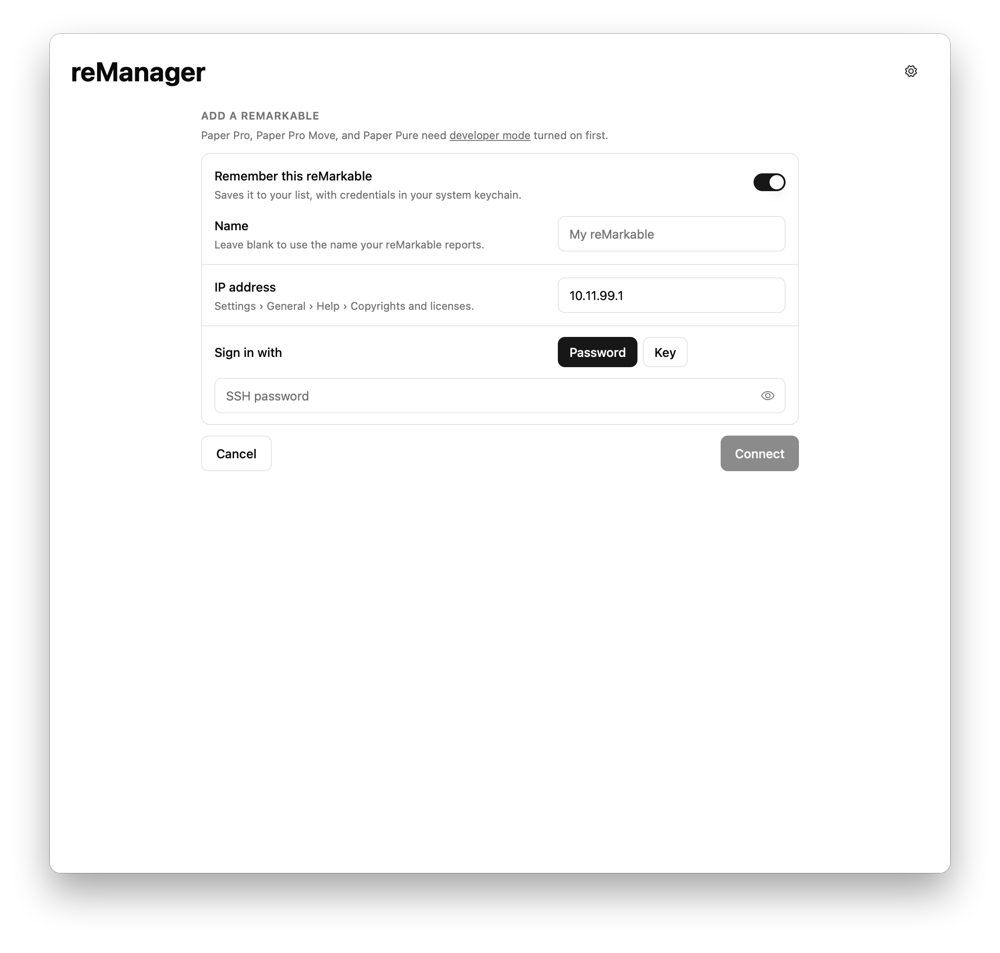

1. Leave **Remember this reMarkable** on to save it to your list. Turn it off for a one-time connection.
2. Optional: type a **Name**.
3. Enter the **IP address**.
4. In **Sign in with**, select **Password**, **Key**, or **Agent**, and enter the details.
5. Click **Connect**.

reManager keeps saved passwords in your system keychain. To add another reMarkable later, press **Add reMarkable** on the Connect screen.

### Using an SSH Key

Select **Key** and pick a key. On a computer, the list shows your keys in `~/.ssh/`, and **Other…** picks any key file. If your key has a passphrase, enter it.

Phones, tablets, and the Mac App Store build cannot read `~/.ssh`. On those, add the key to reManager first. See [SSH Keys](#ssh-keys).

**Agent** uses the keys in a running SSH agent. It appears only on a computer, and only when the agent has at least one key loaded. The Mac App Store build does not have it. If reManager cannot find your agent, set its path in **Settings › Connection › SSH agent**.

### SSH Keys

To store a key in reManager, open **Settings › Connection › SSH keys** and press **Add a key**. Paste the private key, or choose a file on a computer. reManager does not generate keys. The matching public key must already be in `authorized_keys` on your reMarkable.

## Saved reMarkables

Saved reMarkables are listed on the Connect screen. You can edit, remove, and sort them. On a narrow screen, **Edit** and **Remove** are in the overflow menu of each row.

A saved reMarkable can show badges before you connect. A package icon means that mod upgrades are available. A blue CPU icon means that an OS update is available. A gray CPU icon means that an OS update is available, but some installed mods do not support it yet. reManager compares the OS version and mods from your last connection with the current catalog and the latest OS release. If the mods or OS on the reMarkable change outside reManager, the badges may be out of date until you connect again.

On Apple devices, iCloud syncs your saved reMarkables, stored keys, most settings, starred mods, and followed developers across your Macs, iPhones, and iPads.

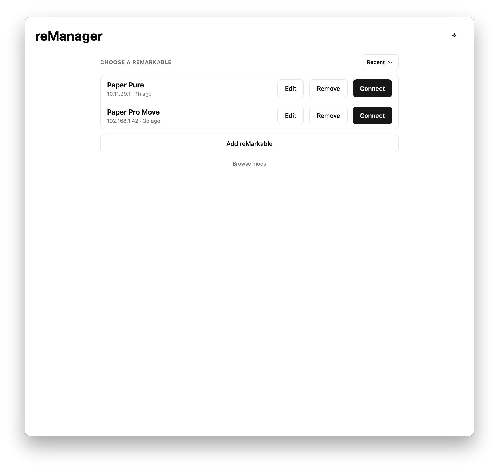

## If the Connection Drops

If reManager loses the connection, it tries to reconnect up to five times. If that fails, press **Disconnect**. For a saved reMarkable, you can also press **Reconnect** to try again. If the password is wrong, or a different reMarkable answers at the address, press **Disconnect** and connect again.

# Managing Mods

## Browsing Packages

The **Mods** tab has three sub-tabs:

- **Discover** — browse the catalog
- **Installed** — mods on your reMarkable
- **Upgrades** — installed mods that have a newer version

\

At the top of **Discover**, filters narrow the catalog by category, or to your **Starred** mods. **Overview** shows shelves of popular and recently added mods, and new mods from developers that you follow. In a filtered list, you can change the sort order.

To reload the catalog, press the refresh button next to the search field. To browse the catalog without a connection, press **Browse mods** below your list of saved reMarkables.

In lists and search results, you can switch between a grid and a list. Narrow screens always use the grid.

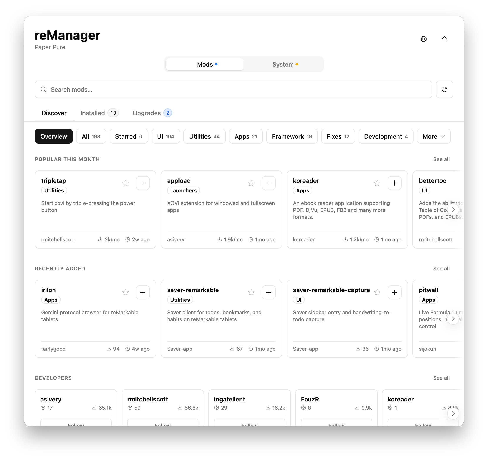

### Search

Type in the "Search mods…" field, or press `/` on a computer. Search looks at the name, author, and description of each mod.

### Starred Mods and Followed Developers

To star a mod, press the star on its card or in its details. To add every starred mod that is not installed, open the **Starred** filter and press **Add all**. This helps on another reMarkable, or after you reinstall Vellum.

To follow a developer, press **Follow** on the developer's card or page. Their new mods then appear on the Overview, and the Discover sub-tab counts the ones that you have not seen. Press **Mark seen** on a card to clear it from the count.

### Deprecated and Incompatible Mods

A "Deprecated" mod will leave the catalog. An "Unmaintained" mod gets no more upgrades, and can stop working on newer OS versions.

Incompatible mods collapse into one group at the bottom of a list. Each card shows the reason, such as "Other models" or "Needs OS …".

## Viewing Package Details

Click a mod to open its details. **Overview** shows the README, and **Changelog** shows the release history. The **Details** panel lists the version, license, supported models and OS versions, dependencies, and conflicts. Click a dependency or conflict to open it.

The main button is **Add**, **Add upgrade**, or **Remove**. When the mod is already in your changes, the button takes it back out. If the developer has a donation link, the details also have **Donate**.

If an installed mod no longer runs on your OS, the details show "Installed, but no longer compatible", and the main button is **Remove**.

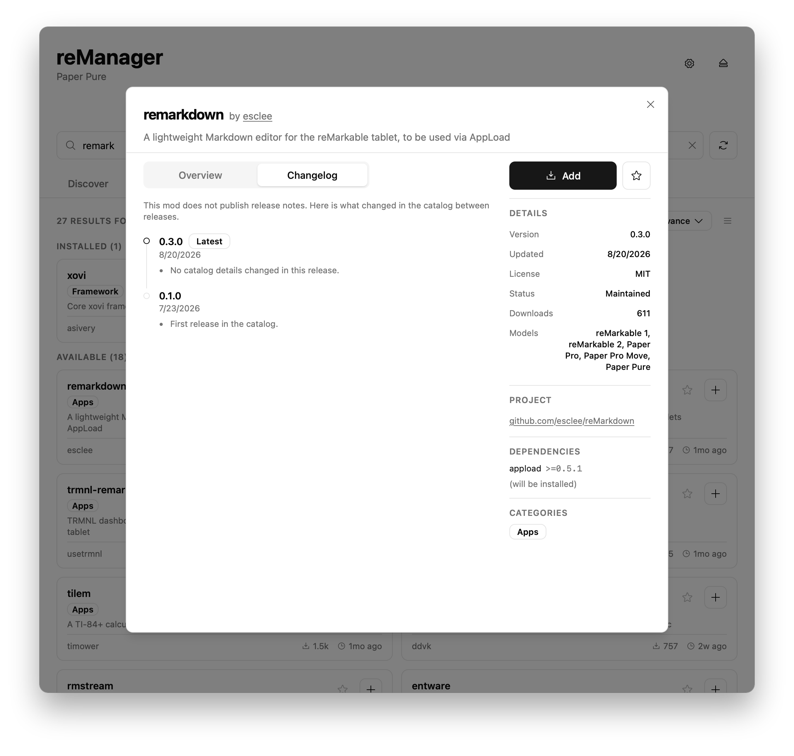

### Mod Links

A `remanager://package/<name>` link on the web catalog opens that mod in reManager, on any platform.

## Making Changes

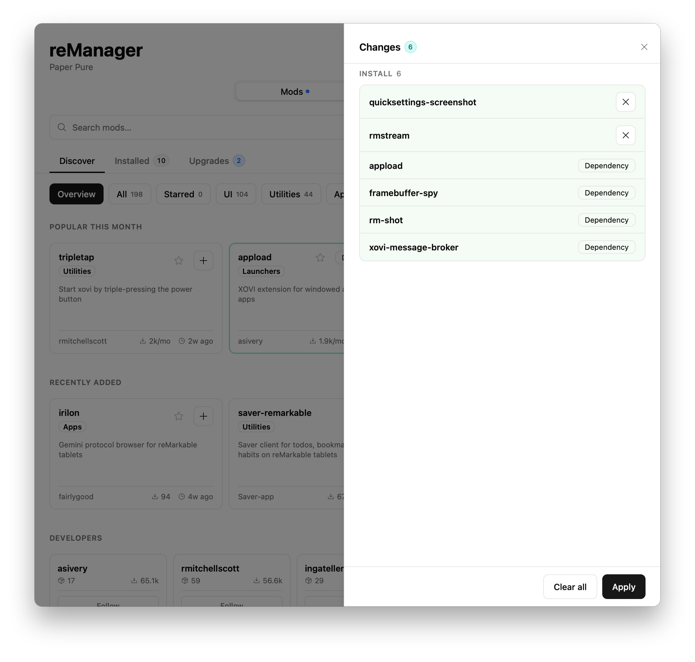

reManager collects installs, upgrades, and removals, and applies them together.

1. Click **+** on a mod's card, or **Add** in its details. The Changes bar appears.
2. Add any other changes.
3. On the Changes bar, press **Show** to review the changes.
4. Answer any questions. See [Questions Before Apply](#questions-before-apply).
5. Click **Apply**.

\

reManager adds the dependencies that your changes need, and lists them with the label "Dependency". Mods that must be removed for your changes to work show "Also removed". To take a change out, press the **X** on its row. To start over, press **Clear all**.

If two mods conflict, reManager does not apply the changes until you remove one of them. You can stage the conflicting mod for removal in the same set of changes.

### Questions Before Apply

Some mods need an answer before they install. The questions show at the top of the Changes panel, and **Apply** stays disabled until you answer them. Press a question, select an option, and press **Continue**. To change an answer later, press **Change**. The questions are:

- Which mod to use, when more than one mod can satisfy a dependency. Press **More info** to see an option's details.
- For Oxide, whether to install launcherctl. Oxide needs launcherctl to start.
- For UI mods, whether to install tripletap. UI mods need a manual start after every reboot, and tripletap starts them when you triple-press the power button.

### While Changes Apply

The Changes bar shows the progress on every tab. To see the output, click the arrow next to "Applying *n* changes". To stop the remaining changes, press **Stop**. After qt-resource-rebuilder installs, reManager asks to build the hashtable, and then offers to start your mods.

On a phone or tablet, reManager tries to keep the changes running when you switch to another app. A notification shows the progress, and tells you if the changes fail or need an answer. When changes start, reManager can ask for permission to send notifications. reManager also keeps the screen awake, because a locked iPhone can drop its USB connection to your reMarkable.

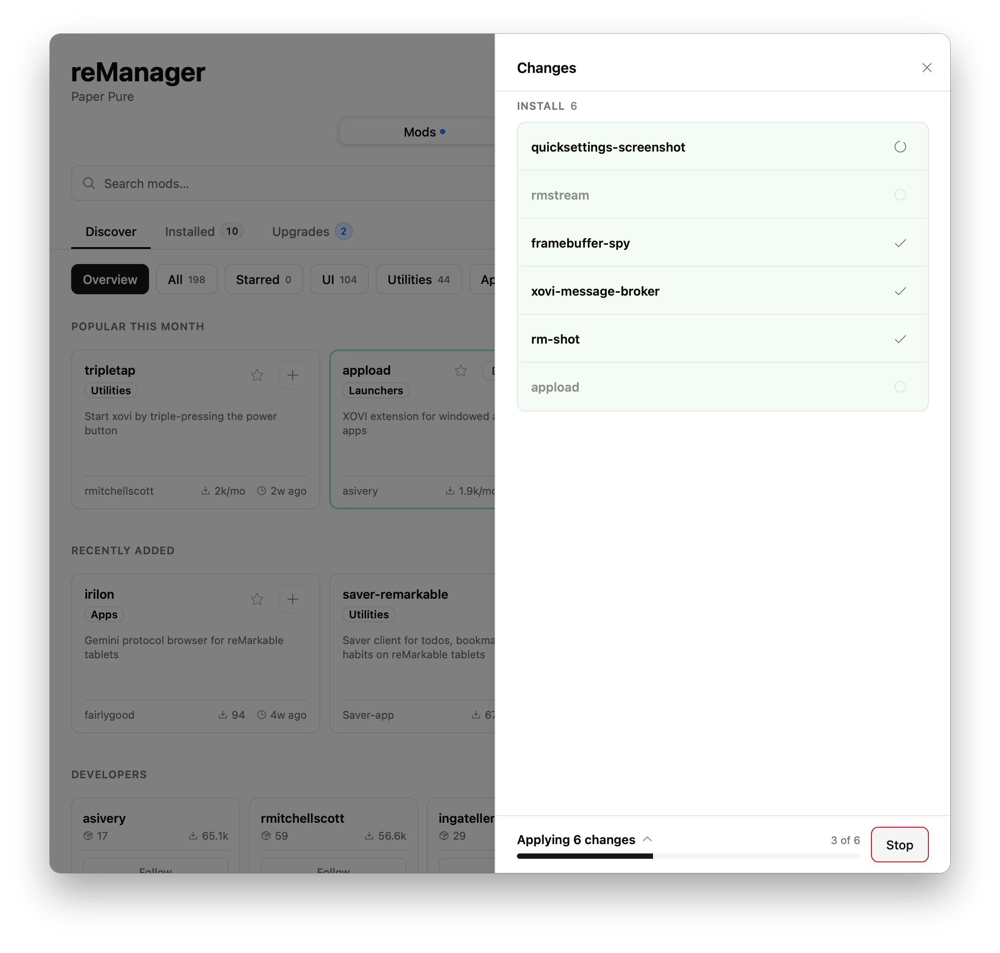

When the changes finish, the Changes bar shows the result. If a change fails, the Changes panel shows the error, and **Retry** runs the changes that did not run.

## Upgrading Mods

Open the **Upgrades** sub-tab. To stage one upgrade, press its upgrade button. To stage all of them, press **Add all**.

## Removing Mods

In the **Installed** sub-tab, press the trash icon on a card, or press **Remove** in the details. To uninstall Vellum itself, see [Advanced](#advanced).

# System

The **System** tab shows Status, Tools, and, when Vellum is installed, Advanced.

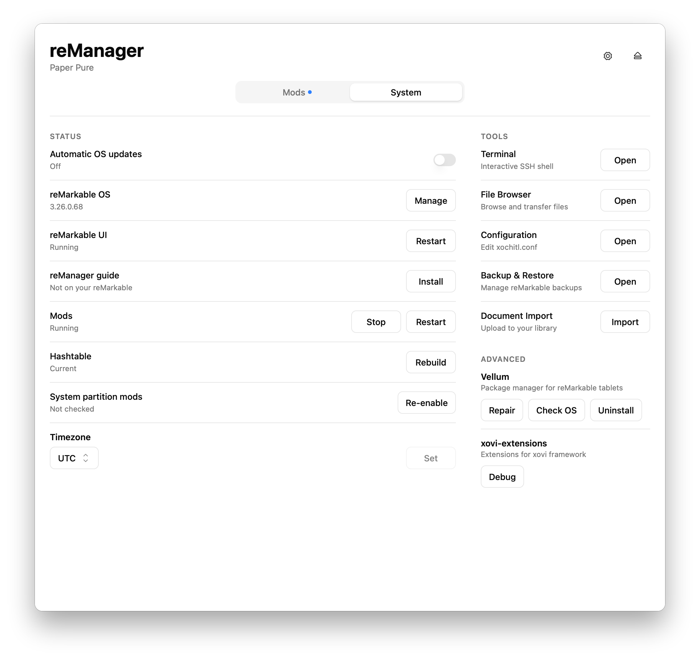

## Status

Each Status row shows one part of your reMarkable. When a row needs attention, it changes color, and its button is the fix. The dot on the System tab shows the color of the most serious row: red for a failure, amber for a warning, and blue for information. The dot is also blue while a Terminal shell runs. If you connect to a different reMarkable and a row is red or amber, reManager opens on the System tab.

- **Automatic OS updates** — a switch. Turn it off while you use mods, so an OS update does not break them.
- **reMarkable OS** — the current version. **Manage** opens the OS Manager.
- **reMarkable UI** — **Restart** restarts the reMarkable UI. It is disabled while a launcher is set.
- **Sleep screen** — choose a PNG for the sleep screen, or reset it.
- **reManager guide** — install or update this guide on your reMarkable. An update loses the highlights and notes in the old copy.
- **Launcher** (with launcherctl) — start or stop the launcher.
- **Mods** (with xovi-extensions) — start, restart, or stop mods. These buttons are disabled while a launcher is set.
- **Hashtable** (with qt-resource-rebuilder) — rebuild the hashtable when it does not match the OS.
- **System partition mods** — re-enable mods that an OS update cleared.
- **Timezone** — set your reMarkable's timezone when it does not match yours.

## After an OS Update

When your reMarkable's OS changes, Status turns into numbered steps that finish the update: Automatic OS updates, Compatibility, System partition mods, Hashtable, Mods, Launcher, and Timezone. Steps for things that you do not have are skipped. Only the next step has a highlighted button.

In the Compatibility step, press **Review**. The Changes panel lists the mods that do not work on the new OS, and the mods with an upgrade for it. Remove the incompatible mods, or use the OS Manager to go back to an OS that they support. Then press **Apply**, and press **Done** to go back to the steps. If no mod needs a change, the Compatibility button is **Finish** instead. The Mods tab is unavailable until you finish the steps.

## Advanced

Advanced has extra commands for Vellum and for some mods.

- **Repair** reinstalls Vellum. Your installed mods stay.
- **Check OS** shows which of your mods work on an OS version that you type.
- **Uninstall** removes Vellum, and by default your installed mods too.

## Running Commands

Most commands open a progress dialog. Press **Details** to see the output. Some commands cannot cleanly stop, so reManager asks before it stops them.

# Tools

Tools are in the System tab: Terminal, File Browser, Configuration, Backup & Restore, and Document Import. The OS Manager opens from the reMarkable OS row in Status. See [OS Manager](#os-manager).

## Terminal

Terminal opens an SSH shell on your reMarkable. The buttons at the top right copy the output and stop the shell. If you close the terminal, the shell keeps running, and you can resume it from Tools.

On a touch screen, a key bar above the keyboard adds Ctrl, Esc, Tab, the arrow keys, and common symbols.

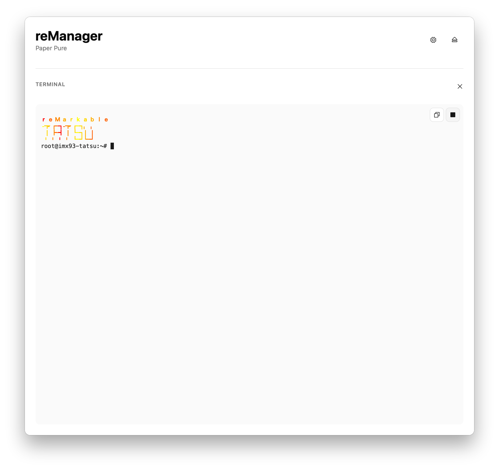

## File Browser

Browse the files on your reMarkable, and transfer files to and from it.

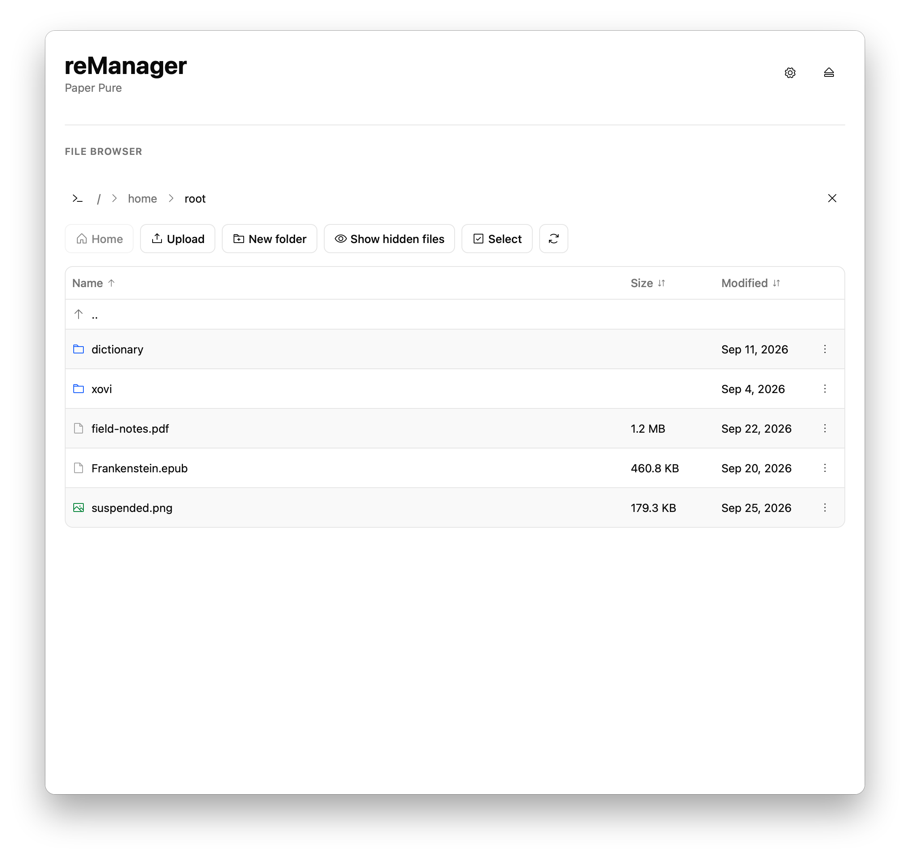

### Navigating

- Click a folder to open it, or click a part of the path at the top to go back to it
- Click the terminal icon to type a path
- Click **Home** to go to `/home/root`
- Click **Show hidden files** to show files whose names start with a dot
- Click a column heading to sort by it

On a narrow screen, hidden files and sorting are in the overflow menu.

### Uploading and Downloading

To upload, press **Upload**, or drag files or folders into the browser on a computer. To download, select **Download** in a row's menu. On a phone or tablet, the share sheet or a save dialog opens when the download is done.

A panel above the file list shows the transfers. To cancel them, press its **X**. An upload replaces files that have the same name without asking.

### Managing Files

Each row has a menu with its actions. On a computer, you can also right-click a row. To work on more than one row, press **Select**, or long-press a row on a touch screen. Then press **Move** or **Delete**. To move, go to the destination folder and press **Move here**. You cannot move files between the home and system partitions.

To make a folder, press **New folder** in the toolbar.

To use a PNG as the sleep screen, select **Set as sleep screen** in its menu. To go back to the default, use the Sleep screen row in Status.

Before the File Browser changes anything outside `/home/root`, it asks "Modify system files?". You can turn this off in **Settings › Prompts & warnings**.

## Configuration

Configuration opens `xochitl.conf` in an editor. reManager does not save a file that is not valid INI. Changes take effect after the UI restarts or your reMarkable reboots.

**Backup** saves a copy of `xochitl.conf` on your reMarkable, and **Restore** lists these copies. They are not the full backups from Backup & Restore.

## Backup and Restore

Backups include your documents and configuration. They do not include installed mods or reManager settings.

### Creating a Backup

1. Click **Back up**.
2. Choose where to save the file. On a phone or tablet, the share sheet opens when the backup is done.

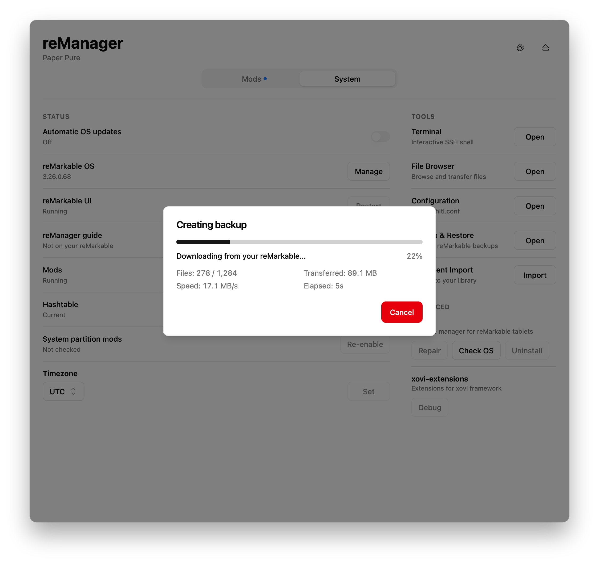

### Restoring a Backup

1. Click **Restore** and pick a backup file.
2. Press **Restore** to confirm. If the backup is from a different reMarkable, the dialog warns you. Your reMarkable is unresponsive until the restore finishes.
3. If you have a passcode, enter it on your reMarkable.

The restore keeps documents that you added after the backup. reManager restarts the UI itself, so you do not need to reboot.

## Document Import

Import PDF, EPUB, and rmdoc files to your reMarkable without the reMarkable cloud.

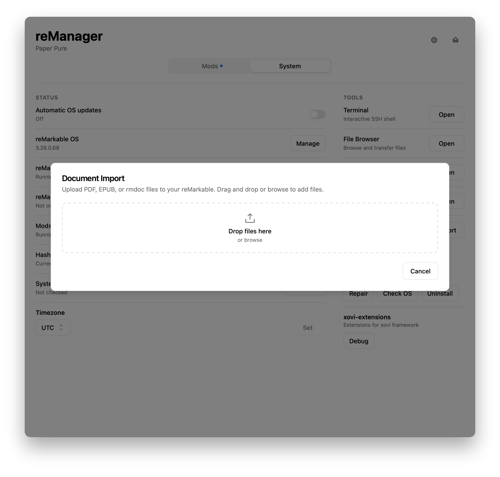

1. Drag files into the import area, or press **Choose files**.
2. Optional: change the display name. For a PDF, you can also change the page count and the cover page.
3. Click **Import**.

**Restart UI after import** is on by default, so the documents appear immediately. If the librarian mod is installed and running, reManager rescans the library instead.

## OS Manager

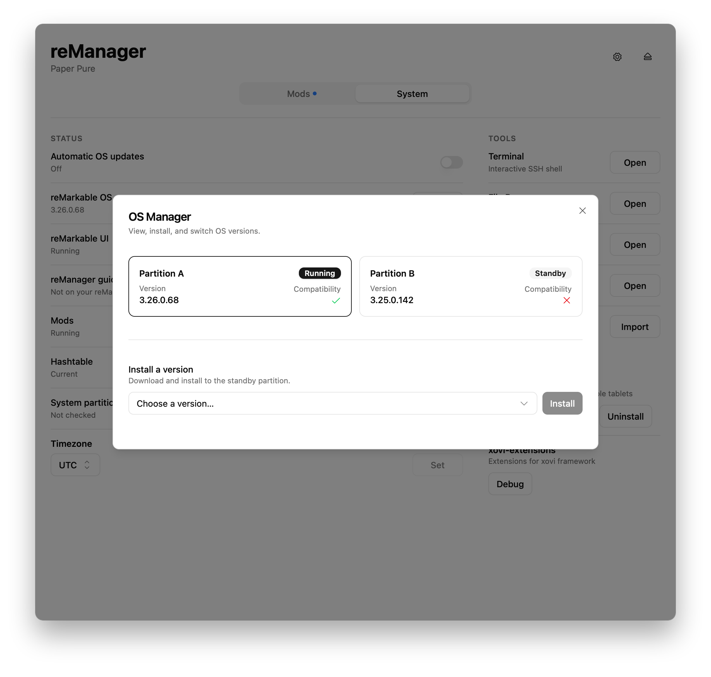

The OS Manager shows the two boot partitions and which one runs next. To switch, click the other partition.

To install a different OS version, pick it from the list and press **Install**. If Vellum is installed, the OS Manager checks your mods against that version first. If some mods are incompatible, you can still press **Install anyway**. Reboot to finish the install.

If your reMarkable runs an OS older than 3.11.2.5, install 3.11.2.5 first. Newer versions need it.

reManager does not support reMarkable OS beta releases. If your reMarkable runs one, reManager tells you when you connect.

# Settings

To open Settings, press the gear icon.

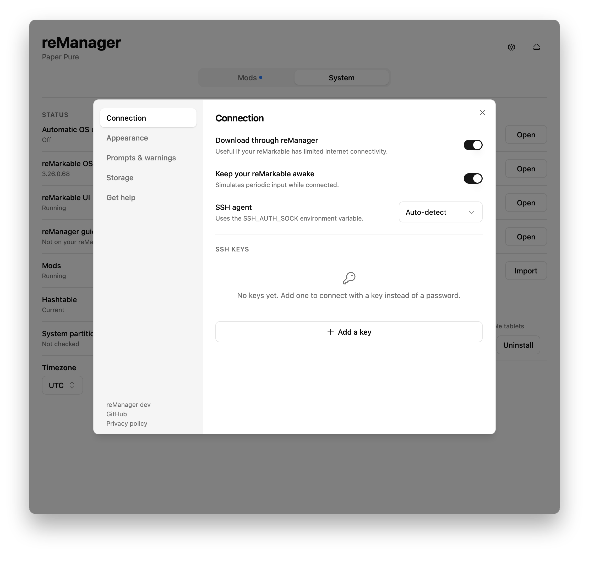

## Connection

- **Download through reManager** — your computer, phone, or tablet downloads mods and sends them to your reMarkable. On by default
- **Keep your reMarkable awake** — stops your reMarkable from sleeping while reManager is connected. On by default
- **SSH agent** — **Auto-detect**, or a **Custom path** to your agent socket. Computer only
- **SSH keys** — keys stored in reManager. See [SSH Keys](#ssh-keys)

## Appearance

- **Theme** — **Light**, **Dark**, or **System**
- **Terminal theme** and **Editor theme** — **Match reManager**, **Dark**, or **Light**

## Prompts & Warnings

- **Warn before changing system files** — the File Browser asks before it changes anything outside `/home/root`. On by default
- **Notify me about reManager updates** — tells you when a new version of reManager is available. Not on phones and tablets, or in the Microsoft Store and Mac App Store builds, where the store updates reManager

## Storage

- **Cached device information** — **Clear** removes the saved information behind the badges on your saved reMarkables
- **Command logs** — **Delete** removes stored command output. reManager deletes logs after 30 days

# Tips and Troubleshooting

Start with the System tab. Most problems show as a colored row in Status, and the row's button is the fix.

## Connection Issues

### I cannot connect to my reMarkable

- On the Paper Pro, Paper Pro Move, and Paper Pure, make sure developer mode is on
- On iPhone and iPad, allow Local Network access in **Settings › reManager**
- Make sure your reMarkable is awake, and connected over USB or to the same Wi-Fi network
- Check the IP address. Over USB, it is `10.11.99.1`
- Check the password. Passwords are case-sensitive, and some characters look alike, such as an uppercase I and the number 1

### reManager says my reMarkable was saved on another device

The reMarkable synced from another device that used a key that is not available here. Pick a stored SSH key, or add one.

### The connection drops during operations

- Make sure **Keep your reMarkable awake** is on in **Settings › Connection**
- Use USB if you can. It is more reliable than Wi-Fi

## Package Issues

### I do not see my mods

Open the System tab and look for a colored row:

- Mods is not running: press **Start**
- Mods is blocked by the hashtable, or the hashtable is not current: press **Rebuild** on the Hashtable row
- System partition mods were cleared by an OS update: press **Re-enable**, or follow [After an OS Update](#after-an-os-update)
- The launcher is not running: press **Start**

Also check these:

- AppLoad apps open from the AppLoad button in the sidebar of the main navigator
- Mods need a manual start after every reboot. Install tripletap and triple-press the power button, or start Mods from the System tab
- If a mod crashes, run **System › Advanced › xovi-extensions › Debug** to capture the error. Then send a support bundle

### I installed a launcher, but my screen does not change

- Oxide needs launcherctl to start. If you declined launcherctl, install it, then press **Start** on the Launcher row
- To change the launcher, use **System › Advanced › launcherctl › Switch**

### When will a mod be added or upgraded?

- Please do not ask for timelines or release dates
   - Unpaid members of the community maintain reManager, Vellum, and the packaged software. They have jobs and lives
   - OS updates usually need changes to UI mods, and testing. This work cannot start until the new OS version is fully released
- If a newer version of a packaged project exits, open an issue at github.com/vellum-dev/vellum to flag it

### A mod shows as incompatible

- The badge on the card gives the reason. If the mod needs a different OS version, you can switch in the OS Manager
- reMarkable OS beta releases are not supported

### DNS error

Your reMarkable could not look up a server while it downloaded packages. Press **Download through reManager** in the dialog.

### My reMarkable's shell prints output over SSH

A `.bashrc` that prints output breaks file transfers. reManager shows a fix in the dialog: copy it to the top of `~/.bashrc`, then press **Try again**.

# Getting Help

Open **Settings › Get help**.

**Report a problem** sends a description, and optionally a support bundle, to the reManager developer.

**Community chat** opens the Discord server. It can make a support bundle first and copy its link for you.

Report package issues at github.com/vellum-dev/vellum. Report problems with a mod itself to its project, which the **Project** row in its details links to.

## Support Bundles

A support bundle collects diagnostic data about reManager and your reMarkable. To make one, open **Support bundles** and press **New bundle**. Then save it, or upload it to get a link that you can share.

To add newer data to an uploaded bundle, press **Update**. The link stays the same. Uploaded bundles expire 30 days after the last upload or update. To delete one from the server sooner, press **Delete**.
